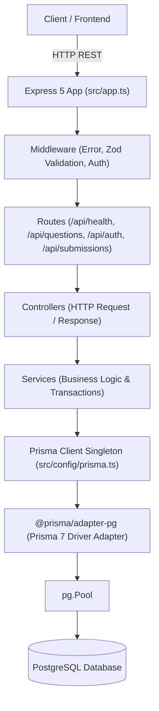
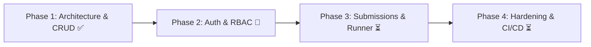

# AlgoVault API — Agent Guidelines, Architecture & Project Roadmap

> **Document Version:** 2.0.0  
> **Last Updated:** October 2026  
> **Project Scope:** High-performance, strongly-typed backend engine for algorithmic coding challenges, technical interview prep, and code execution.  
> **Primary Purpose:** Autonomous Agent & Developer Single Source of Truth for architecture, decisions, progress tracking, and seamless session resumption.

---

## 🤖 Agent Quick-Resume Protocol

Whenever an agent or developer begins or resumes work on this repository:
1. **Read this file first** to immediately know the active phase, recent architectural decisions, and next steps.
2. **Verify build health:** Run `npx tsc --noEmit` and `npm run build` to ensure the TypeScript build has zero errors.
3. **Verify database status:** Run `npx prisma migrate status` to confirm migrations are in sync.
4. **Adhere to core invariants:**
   - **NodeNext ESM Imports:** Relative local imports **must** include the `.js` extension (e.g., `import prisma from '../config/prisma.js';`).
   - **Singleton Prisma 7 Adapter:** Never instantiate `new PrismaClient()`. Always import the singleton from `src/config/prisma.js`.
   - **Zod 3 Validation:** Always validate `req.body`, `req.query`, and `req.params` via `validateRequest` middleware before reaching controllers.
   - **Atomic Writes:** Use Prisma nested writes or `$transaction` for related entity mutations.
5. **Update this document:** Once your phase or milestone completes, update the checklist, log your architectural decisions in the Phase Log, and commit your changes.

---

## 1. Project Overview & Architecture

**AlgoVault API** (DevPrep API) is a RESTful backend service built to power a LeetCode/HackerRank-style developer preparation platform. It manages algorithmic problems, test suites, user profiles, submissions, and code execution metrics.

### System Architecture Diagram


### Tech Stack Specifications
* **Runtime:** Node.js (v20+ recommended, v18+ minimum) with native ES Modules (`"type": "module"`)
* **Framework:** Express.js 5.x
* **Language:** TypeScript 5.x (`strict: true`, `"module": "nodenext"`, `"verbatimModuleSyntax": true`)
* **Database:** PostgreSQL (v15+)
* **ORM:** Prisma 7.x (`@prisma/adapter-pg` + `pg.Pool`)
* **Request Validation:** Zod 3.x
* **Containerization:** Multi-stage Docker & Docker Compose

---

## 2. Current State Assessment

| Component | Status | Details |
| :--- | :--- | :--- |
| **Code Structure** | ✅ Completed | Clean layered architecture: `src/config/`, `src/validators/`, `src/middleware/`, `src/services/`, `src/controllers/`, `src/routes/`, and `src/app.ts`. |
| **Request Validation** | ✅ Completed | Comprehensive Zod schemas for request params, query filters, and payloads with centralized `validateRequest` middleware. |
| **Question CRUD** | ✅ Completed | Full CRUD: `GET /api/questions` (with pagination, tag filter, difficulty filter, search), `GET /api/questions/:id`, `POST /api/questions`, `PUT /api/questions/:id`, and `DELETE /api/questions/:id`. |
| **Docker & Deployment** | ✅ Completed | Production-ready multi-stage `DockerFile` (builder + runner stages) and `.dockerignore`. |
| **Database & Schema** | ⚠️ Partial | `Question` and `TestCase` models exist in Prisma. `User` interface exists in `src/types.ts` but needs Prisma schema migration. `Submission` model is pending. |
| **Authentication & AuthZ** | 🔄 Next Up (Phase 2) | User registration, login, JWT issuance, password hashing, and role-based access control (`USER` vs `ADMIN`). |
| **Code Execution Engine**| ⏳ Pending (Phase 3) | Sandbox runner to execute submitted code solutions against test cases with time/memory limits. |
| **Testing** | ⏳ Pending (Phase 4) | Unit & integration test suites (Supertest / Vitest / Jest). |

---

## 3. Phase Log & Architectural Decision Records (ADRs)

### Phase 1: Architecture Refactoring, Question CRUD & Dockerization
* **Status:** ✅ Completed (Commit `c1f294c`)
* **Deliverables:**
  - `src/config/prisma.ts`: Centralized Prisma client singleton with PG adapter and pool.
  - `src/validators/question.validator.ts`: Zod schemas for question creation, update, filtering query, and UUID param.
  - `src/middleware/validate.middleware.ts`: Reusable Zod validation middleware formatting 400 Bad Request responses.
  - `src/middleware/error.middleware.ts`: Global error handler with Prisma error code translation (`P2025` -> 404, `P2002` -> 409) and 404 route handler.
  - `src/services/question.service.ts`: Query builder, pagination calculations, nested creation, and atomic update transactions.
  - `src/controllers/question.controller.ts` & `src/controllers/health.controller.ts`: Controller handlers.
  - `src/routes/question.routes.ts`, `src/routes/health.routes.ts`, and `src/routes/index.ts`: Route definitions.
  - `src/app.ts`: Decoupled Express application factory.
  - `DockerFile`: Multi-stage build (Node 20 alpine builder -> Node 20 alpine runner).
  - `.dockerignore`: Filtered node_modules, dist, git, and local envs.

#### Key Architectural Decisions & Thinking in Phase 1:
1. **Decision: Zod 3 vs Zod 4**
   - *Context:* Running `npm i zod` initially pulled `zod@^4.6.7`. Zod v4 altered foundational exports (removed `AnyZodObject`, changed `.errors` to `.issues`, modified `$ZodStringParams`), leading to build errors with standard Express validation middleware.
   - *Choice:* Reverted to `zod@^3.23.8`. Zod 3 is rock solid, widely compatible, and provides complete type inference without experimental breaking changes.
2. **Decision: Decoupling `app.ts` from Server Listener**
   - *Context:* Monolithic `src/index.ts` previously combined Express configuration, routes, and `app.listen()`.
   - *Choice:* Extracted Express configuration into `src/app.ts` (`createApp()`) and kept server listening isolated. This allows Supertest in Phase 4 to mount `app` directly in memory without binding network ports or conflicting during parallel test runs.
3. **Decision: Strict NodeNext Relative Imports (`.js` extension)**
   - *Context:* The project `tsconfig.json` specifies `"module": "nodenext"` and `"moduleResolution": "nodenext"`.
   - *Choice:* All internal relative imports must explicitly state `.js` (e.g. `import app from './app.js'`). Omitting extensions causes TypeScript compiler failure TS2835.
4. **Decision: Atomic Nested Transactions for Question & TestCase Mutations**
   - *Context:* Updating a question's test cases can lead to orphaned test cases if an error occurs midway.
   - *Choice:* In `question.service.ts`, test case replacements are wrapped in `prisma.$transaction(async (tx) => { ... })` deleting old cases and creating new ones atomically.
5. **Decision: Multi-Stage Containerization with Unprivileged User**
   - *Context:* Docker image size and security.
   - *Choice:* Multi-stage `DockerFile` splits compilation (TypeScript + Prisma engines) from runtime. The production container runs with `npm ci --omit=dev` under `USER node`, preventing container breakout vulnerabilities.

---

## 4. Detailed Project Roadmap & Future Phases



---

### Phase 2: User Authentication & Role-Based Access Control (RBAC)
* **Status:** 🔄 **ACTIVE / IN PROGRESS**
* **Goal:** Enable user registration, login, JWT token verification, and role-based access control (`USER` vs `ADMIN`).

#### Technical Specifications & Planned Steps:
- [ ] **2.1 Database Schema Extensions**
  - Update `prisma/schema.prisma`:
    ```prisma
    enum Role {
      USER
      ADMIN
    }

    model User {
      id           String       @id @default(uuid())
      username     String       @unique
      email        String       @unique
      passwordHash String
      role         Role         @default(USER)
      createdAt    DateTime     @default(now())
      updatedAt    DateTime     @updatedAt
      submissions  Submission[]
    }
    ```
  - Add `isHidden Boolean @default(false)` to `TestCase` model.
  - Run migration: `npx prisma migrate dev --name add_user_model`.
- [ ] **2.2 Auth Utilities & Dependencies**
  - Install dependencies: `npm install bcryptjs jsonwebtoken` and devDependencies `npm install -D @types/bcryptjs @types/jsonwebtoken`.
  - Create `src/utils/jwt.ts`: Token signing and verification helpers.
  - Create `src/utils/password.ts`: Password hashing (`bcrypt.hash(pwd, 10)`) and comparison (`bcrypt.compare`).
- [ ] **2.3 Validators, Services & Controllers**
  - Create `src/validators/auth.validator.ts`:
    - `registerSchema`: `email` (valid email), `username` (alphanumeric, min 3, max 30), `password` (min 8).
    - `loginSchema`: `email` (or username), `password`.
  - Create `src/services/auth.service.ts`:
    - Register: Checks uniqueness, hashes password, saves user, returns safe user object (excluding `passwordHash`).
    - Login: Verifies credentials, generates JWT access token containing `{ userId, role, email }`.
  - Create `src/controllers/auth.controller.ts`: HTTP request handlers for register, login, and `/me`.
  - Create `src/routes/auth.routes.ts`: Mounted at `/api/auth`.
- [ ] **2.4 Authentication & RBAC Middleware**
  - Create `src/middleware/auth.middleware.ts`:
    - `authenticateToken`: Reads `Authorization: Bearer <token>`, verifies JWT, populates `req.user`.
    - `requireRole(role)`: Guards admin-only routes.
  - Protect Question mutation routes:
    - `POST /api/questions` -> requires `ADMIN`.
    - `PUT /api/questions/:id` -> requires `ADMIN`.
    - `DELETE /api/questions/:id` -> requires `ADMIN`.
    - Regular users can only access `GET /api/questions` and `GET /api/questions/:id`.

---

### Phase 3: Submissions & Code Execution Engine
* **Status:** ⏳ **UPCOMING**
* **Goal:** Enable candidates to submit code solutions in Python, JavaScript, TypeScript, C++, and evaluate them against test cases.

#### Technical Specifications & Planned Steps:
- [ ] **3.1 Submissions Data Modeling**
  - Update `prisma/schema.prisma`:
    ```prisma
    enum Language {
      PYTHON
      JAVASCRIPT
      TYPESCRIPT
      CPP
      JAVA
    }

    enum SubmissionStatus {
      PENDING
      ACCEPTED
      WRONG_ANSWER
      TIME_LIMIT_EXCEEDED
      MEMORY_LIMIT_EXCEEDED
      RUNTIME_ERROR
      COMPILATION_ERROR
    }

    model Submission {
      id              String           @id @default(uuid())
      userId          String
      user            User             @relation(fields: [userId], references: [id], onDelete: Cascade)
      questionId      String
      question        Question         @relation(fields: [questionId], references: [id], onDelete: Cascade)
      code            String
      language        Language
      status          SubmissionStatus @default(PENDING)
      runtimeMs       Int?
      memoryKb        Int?
      errorOutput     String?
      passedTestCases Int              @default(0)
      totalTestCases  Int              @default(0)
      createdAt       DateTime         @default(now())
    }
    ```
  - Run migration: `npx prisma migrate dev --name add_submission_model`.
- [ ] **3.2 Execution Engine Architecture**
  - **Runner Strategy:**
    - Option A: Self-contained runner using isolated sandboxes (temporary container or `isolated-vm` with strict memory & CPU timeouts).
    - Option B: Judge0 API integration (or BullMQ worker queue processing tasks asynchronously).
  - Test case privacy: During regular `GET /api/questions/:id`, exclude `testCases` where `isHidden == true`. During submission execution, evaluate all test cases.
- [ ] **3.3 Endpoints**
  - `POST /api/submissions`: Create submission, trigger evaluation, return initial or completed verdict.
  - `GET /api/submissions/:id`: Get submission status and performance stats.
  - `GET /api/questions/:id/submissions`: Get history of submissions for a question by authenticated user.
  - `GET /api/users/profile/stats`: Solved problems grouped by difficulty (`Easy`, `Medium`, `Hard`).

---

### Phase 4: Production Hardening, Testing, Documentation & CI/CD
* **Status:** ⏳ **UPCOMING**
* **Goal:** Prepare the service for high traffic, reliability, security audits, and continuous delivery.

#### Technical Specifications & Planned Steps:
- [ ] **4.1 Security & Observability**
  - Install and configure `helmet` for HTTP security headers.
  - Install and configure `cors` with configurable origin whitelist.
  - Install and configure `express-rate-limit` for route DDoS / brute-force protection (e.g. rate limit `/api/auth/login`).
  - Structured request logging (Pino or Winston).
- [ ] **4.2 Automated Testing Suite**
  - Setup Vitest / Jest with `supertest`.
  - Write automated tests:
    - Health route test: `GET /api/health` returns 200.
    - Question CRUD tests: validation checks, pagination, filtering.
    - Auth flow tests: registration, duplicate rejection, login, token verification, admin route blocking.
    - Submissions flow tests: valid execution, wrong answer handling.
- [ ] **4.3 Interactive API Documentation**
  - Configure `swagger-ui-express` and OpenAPI 3.0 specification.
  - Expose interactive docs at `http://localhost:3000/api/docs`.
- [ ] **4.4 CI/CD Pipeline**
  - Create `.github/workflows/ci.yml`:
    - Lint & Typecheck: `npm run build`
    - Automated tests: `npm test`
    - Docker build validation: `docker build -t algovault-api .`

---

## 5. Developer & Agent Cheat Sheet

### Common CLI Commands
```bash
# Start development server
npm run dev

# Compile TypeScript to dist/
npm run build

# Typecheck without emitting files
npx tsc --noEmit

# Prisma schema migration
npx prisma migrate dev --name <migration_name>

# Check migration status
npx prisma migrate status

# Launch Prisma Studio GUI
npx prisma studio

# Build Docker production container
docker build -t algovault-api .
```

### Essential Project Structure
```text
algovault-api/
├── prisma/
│   ├── schema.prisma              # Database models (Question, TestCase, User, Submission)
│   └── migrations/                # Versioned SQL migrations
├── src/
│   ├── app.ts                     # Express app setup and middleware assembly
│   ├── index.ts                   # Entrypoint & HTTP server listener
│   ├── config/
│   │   └── prisma.ts              # Singleton PrismaClient with PG adapter
│   ├── controllers/               # HTTP handlers
│   ├── middleware/                # Validation, error handling, auth guards
│   ├── routes/                    # Express routers
│   ├── services/                  # Database queries & business logic
│   ├── validators/                # Zod schemas
│   └── types.ts                   # Domain TypeScript interfaces
├── DockerFile                     # Multi-stage production container definition
├── .dockerignore                  # Docker context ignore list
├── package.json                   # Dependencies and scripts
├── tsconfig.json                  # Strict NodeNext TypeScript configuration
└── Agents.MD                      # THIS FILE — Single source of truth for all agents
```
