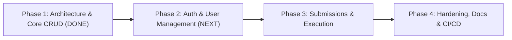
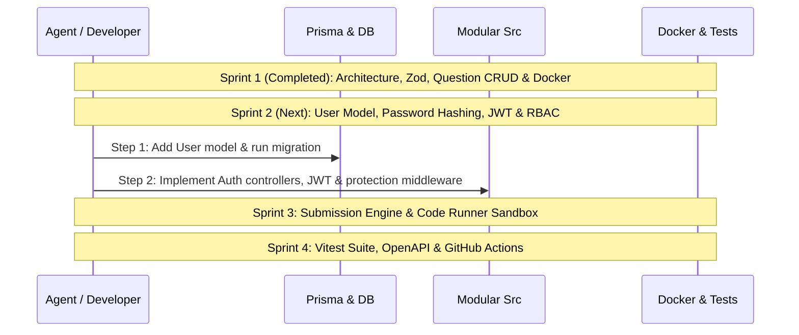

# AlgoVault API — Agent Guidelines & Project Roadmap

> **Document Version:** 1.1.0  
> **Last Updated:** October 2026  
> **Project Scope:** High-performance, strongly-typed backend engine for algorithmic coding challenges, technical interview prep, and code execution.

---

## 1. Project Overview & Architecture

**AlgoVault API** (DevPrep API) is a RESTful backend service built to power a LeetCode/HackerRank-style developer preparation platform. It manages algorithmic problems, test suites, user profiles, submissions, and code execution metrics.

### Tech Stack
* **Runtime:** Node.js (v18+) with native ES Modules (`"type": "module"`)
* **Framework:** Express.js 5.x
* **Language:** TypeScript 5.x (strict type checking enabled, NodeNext module resolution)
* **Database:** PostgreSQL (v15+)
* **ORM:** Prisma 7.x (using `@prisma/adapter-pg` driver adapter and `pg.Pool`)
* **Validation:** Zod 3.x
* **Containerization:** Docker & Docker Compose

---

## 2. Current State Assessment

| Component | Status | Details |
| :--- | :--- | :--- |
| **Code Structure** | ✅ Completed | Clean layered architecture: `src/config/`, `src/validators/`, `src/middleware/`, `src/services/`, `src/controllers/`, `src/routes/`, and `src/app.ts`. |
| **Request Validation** | ✅ Completed | Comprehensive Zod schemas for request params, query filters, and payloads with centralized `validateRequest` middleware. |
| **Question CRUD** | ✅ Completed | Full CRUD: `GET /api/questions` (with pagination, tag filter, difficulty filter, search), `GET /api/questions/:id`, `POST /api/questions`, `PUT /api/questions/:id`, and `DELETE /api/questions/:id`. |
| **Database & Schema** | ⚠️ Partial | `Question` and `TestCase` models exist in Prisma. `User` interface exists in `src/types.ts` but needs Prisma schema migration. `Submission` model is pending. |
| **Docker & Deployment** | ✅ Completed | Production-ready multi-stage `DockerFile` (builder + runner stages) and `.dockerignore`. |
| **Authentication & AuthZ** | 🔄 Next Up (Phase 2) | User registration, login, JWT issuance, password hashing, and role-based access control (`USER` vs `ADMIN`). |
| **Code Execution Engine**| ⏳ Pending (Phase 3) | Sandbox runner to execute submitted code solutions against test cases with time/memory limits. |
| **Testing** | ⏳ Pending (Phase 4) | Unit & integration test suites (Supertest / Vitest / Jest). |

---

## 3. Project Roadmap

### Phase 1: Architecture Refactoring, Question CRUD & Dockerization
**Status:** ✅ **COMPLETED**
- [x] **1.1 Layered Modular Architecture**
  - Created `src/config/prisma.ts` — Centralized singleton PrismaClient with PrismaPg adapter and connection pooling.
  - Created `src/middleware/validate.middleware.ts` — Generic Zod validation middleware for body, query, and params.
  - Created `src/middleware/error.middleware.ts` — Centralized error handling middleware with Prisma error mapping and 404 handler.
  - Created `src/services/question.service.ts` — Encapsulated question queries, nested transactional writes, pagination, and cascade deletions.
  - Created `src/controllers/question.controller.ts` & `src/controllers/health.controller.ts`.
  - Created `src/routes/question.routes.ts`, `src/routes/health.routes.ts`, and aggregated in `src/routes/index.ts`.
  - Created `src/app.ts` Express application factory.
- [x] **1.2 Complete Question & Test Case CRUD**
  - `GET /api/questions`: Paginated (`page`, `limit`), filtered by `difficulty`, filtered by `tag`, and searchable by text (`search`).
  - `GET /api/questions/:id`: Fetch question by UUID with associated test cases.
  - `POST /api/questions`: Nested creation of question + test cases in a single transaction.
  - `PUT /api/questions/:id`: Update question details and replace/update test cases transactionally.
  - `DELETE /api/questions/:id`: Delete question with cascade delete of test cases.
- [x] **1.3 Request Validation with Zod**
  - Strict input schemas for create, update, query parameters, and UUID path parameters.
  - Returns structured `400 Bad Request` with field-level error messages.
- [x] **1.4 Containerization**
  - Multi-stage `DockerFile` (Stage 1: build with TypeScript & Prisma generation; Stage 2: production runtime with unprivileged `node` user).
  - `.dockerignore` for clean build contexts.

---

### Phase 2: User Authentication & Role-Based Access Control (RBAC)
**Status:** 🔄 **IN PROGRESS / NEXT UP**
**Goal:** Introduce secure user accounts, password hashing, JWT authentication, and administrative protection for problem creation.

- [ ] **2.1 Database Schema Extensions**
  - Add `User` model to `prisma/schema.prisma`:
    - `id` (UUID), `email` (unique), `username` (unique), `passwordHash` (string)
    - `role` (Enum: `USER`, `ADMIN`)
    - `createdAt`, `updatedAt`
  - Update `TestCase` model to add `isHidden` (Boolean, default `false`) so hidden test cases are reserved for submissions.
  - Create and run Prisma migration (`npx prisma migrate dev --name add_user_model`).
- [ ] **2.2 Authentication Module**
  - Password hashing using `bcryptjs` or `argon2`.
  - JWT token generation and verification utilities (`jsonwebtoken`).
  - Routes & Controllers:
    - `POST /api/auth/register`: Create user account, hash password.
    - `POST /api/auth/login`: Authenticate credentials, return JWT token.
    - `GET /api/auth/me`: Return current user profile (requires auth).
- [ ] **2.3 Authorization Middleware**
  - `authenticateToken`: Validates Bearer JWT tokens and attaches user to `req.user`.
  - `requireRole('ADMIN')`: Restricts administrative routes (`POST /api/questions`, `PUT /api/questions/:id`, `DELETE /api/questions/:id`).

---

### Phase 3: Submissions & Code Execution Engine
**Status:** ⏳ **UPCOMING**
**Goal:** Enable users to submit algorithmic code solutions in multiple languages, execute them safely against test cases, and record verdicts.

- [ ] **3.1 Submissions Data Modeling**
  - Add `Submission` model to `prisma/schema.prisma`:
    - `id` (UUID)
    - `userId` (relation to `User`)
    - `questionId` (relation to `Question`)
    - `code` (Text)
    - `language` (Enum: `PYTHON`, `JAVASCRIPT`, `TYPESCRIPT`, `CPP`, `JAVA`)
    - `status` (Enum: `PENDING`, `ACCEPTED`, `WRONG_ANSWER`, `TIME_LIMIT_EXCEEDED`, `MEMORY_LIMIT_EXCEEDED`, `RUNTIME_ERROR`, `COMPILATION_ERROR`)
    - `runtimeMs` (Int nullable), `memoryKb` (Int nullable)
    - `passedTestCases` (Int), `totalTestCases` (Int)
    - `createdAt`
  - Run Prisma migration (`npx prisma migrate dev --name add_submission_model`).
- [ ] **3.2 Execution Strategy**
  - Secure sandboxed code runner (isolated runner / worker queue with BullMQ or Judge0 API integration).
- [ ] **3.3 Submissions API**
  - `POST /api/submissions`: Submit code for a question.
  - `GET /api/submissions/:id`: Retrieve execution status, metrics, and test case feedback.
  - `GET /api/questions/:id/submissions`: List user's past submissions for the question.
  - `GET /api/users/stats`: Aggregated stats (total solved, solved by difficulty).

---

### Phase 4: Production Hardening, Testing, Documentation & CI/CD
**Status:** ⏳ **UPCOMING**
**Goal:** Prepare the service for high traffic, reliability, self-documentation, and continuous integration.

- [ ] **4.1 Security & Observability**
  - Security middlewares: `helmet`, `cors`, `express-rate-limit`.
  - Logging: Structured logger (e.g., `pino` or `winston`).
- [ ] **4.2 Automated Testing**
  - Test framework: Vitest / Jest with `supertest`.
  - Integration tests for `/api/health`, `/api/questions`, and `/api/auth`.
- [ ] **4.3 API Documentation**
  - OpenAPI 3.0 specification (`swagger-ui-express`).
  - Interactive documentation at `/api/docs`.
- [ ] **4.4 CI/CD Pipeline**
  - GitHub Actions workflow for linting, typechecking, running tests, and Docker container verification.

---

## 4. Execution Strategy & Sprints

---

## 5. Coding Standards & Agent Guidelines

When modifying this repository, all agents must adhere to the following conventions:

1. **Type Safety & NodeNext:** Avoid `any`. Use strict TypeScript interfaces and Prisma-generated model types. Remember that relative module imports must include `.js` extensions under `"moduleResolution": "nodenext"`.
2. **Database Access:** Always use the centralized Prisma client instance (`src/config/prisma.js`) configured with the Prisma 7 driver adapter. Never instantiate multiple `PrismaClient` instances.
3. **Transactions:** Use Prisma nested writes or `$transaction` for operations that alter multiple related tables.
4. **Validation:** Validate all external inputs (`body`, `query`, `params`) using Zod schemas via `validateRequest` middleware before reaching controllers.
5. **Environment Variables:** Do not hardcode connection strings or secrets. Always use `process.env` validated through configuration.
