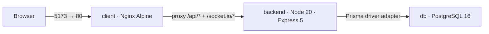

# AlgoVault — Architecture

## Topology

Three Docker Compose services on an internal bridge network:

- `client` serves the React SPA and reverse-proxies `/api/` to `backend:3000` (Nginx), so the browser
  never calls the API cross-origin and there is no CORS surface.
- `backend` is the only service that touches `db`.
- `client` and `backend` are separate dependency graphs and separate processes; they share nothing at
  runtime and communicate over REST and a Socket.io WebSocket.

## Boundaries & dependency edges

- **client → backend** over REST (`/api/*`) and a Socket.io WebSocket (`/socket.io/*`), via the Vite
  dev proxy locally and the Nginx proxy in Docker. No direct access to `db`.
- **backend → db** over Prisma. No other service reaches the database.
- No client → db, backend → client, or service-to-service edge exists beyond the above.

## Invariants (enforced by the code)

- **Never raw SQL** — all data access goes through Prisma Client and Prisma migrations.
- **Zod validation first** — every `POST`/`PUT` body is parsed by a Zod schema in
  `validate.middleware` before any database write.
- **Decoupled app factory** — `createApp()` builds the Express app; `index.ts` only listens, so the
  app can be mounted in-memory (tests/Docker) without a port.
- **Atomic nested writes** — Question + TestCase mutations run in a `$transaction`.
- **Sandboxed execution** — submissions run in a single child process per run (Node or Python 3) under
  a 3.5s timeout and 128MB memory cap.
- **Structured errors** — every response uses the `{ status, message }` envelope; Prisma `P2025` maps
  to 404 and `P2002` to 409 in `error.middleware`.
- **ESM NodeNext** — the backend uses explicit `.js` relative imports.

## Decisions

Distilled from the ADRs recorded in `Agents.MD` (which stays agent instructions, not a spec):

- **Prisma 7 driver adapter** — `@prisma/adapter-pg` over a singleton `pg.Pool`, per Prisma 7's
  requirement that a driver adapter be supplied.
- **Zod 3 over Zod 4** — pinned for stable Express middleware behavior (v4 changed error internals).
- **Native subprocess execution over Judge0/Piston** — keeps the whole stack under ~600MB RAM (fits a
  `t3.micro`); no external rate-limited API.
- **`typescript` as a runtime dependency** — the engine transpiles TS in-process via
  `ts.transpileModule`, so it must exist at runtime, not just build time.
- **Dual multi-stage Docker + Nginx** — the client builds to static assets served by Nginx Alpine; the
  backend runs under `USER node`.
- **Tailwind v4 via `@tailwindcss/vite`** — zero-config v4 pipeline inside the Vite build.
- **JWT in an httpOnly cookie + bcrypt** — stateless auth that fits the decoupled REST + Docker topology;
  a `Secure`-optional cookie keeps the token out of JS reach and rides the same-origin proxy. Roles
  (`Teacher`/`Student`) are enforced by `authenticate`/`authorize` middleware, and a single `Cohort`
  owned by the teacher holds the students.
- **Socket.io on the API server** — realtime sessions + chat ride a WebSocket on the same Node server
  (port 3000) as the REST API, authenticated with the JWT cookie on handshake; Nginx and Vite proxy the
  `/socket.io/` upgrade across the Docker bridge.

## Not yet built

WebRTC screen sharing and the AI reviewer do not exist today; they are the remaining mentorship
capabilities in `algovault` and will each be designed as its own task-spec.
